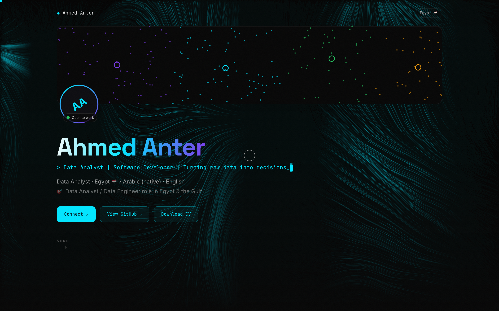
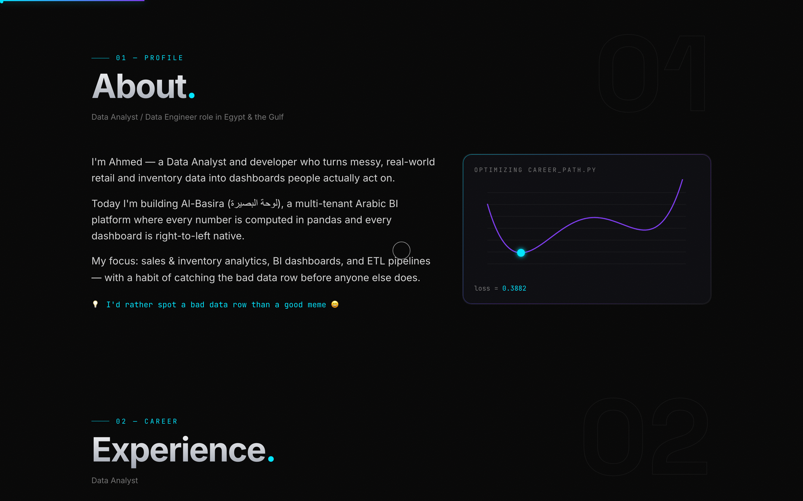
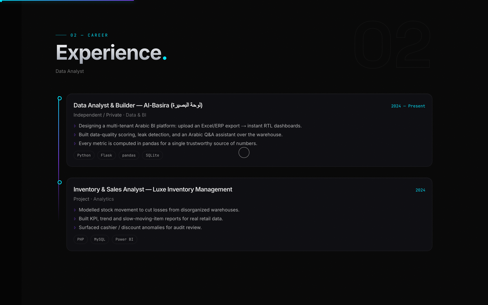
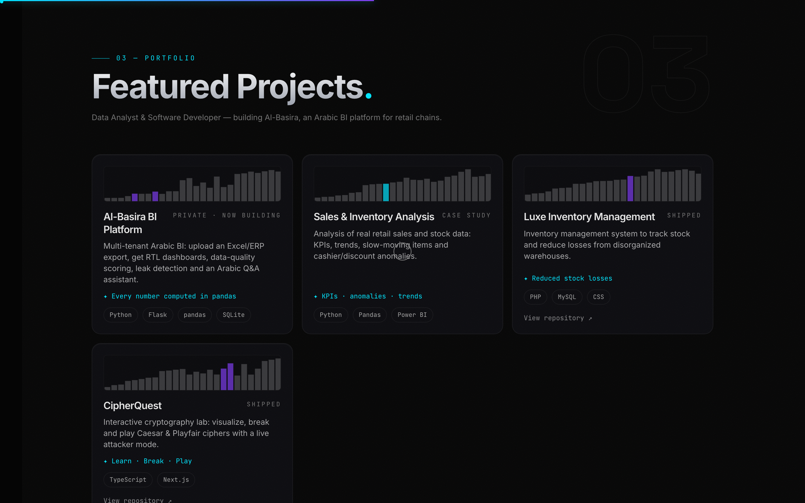
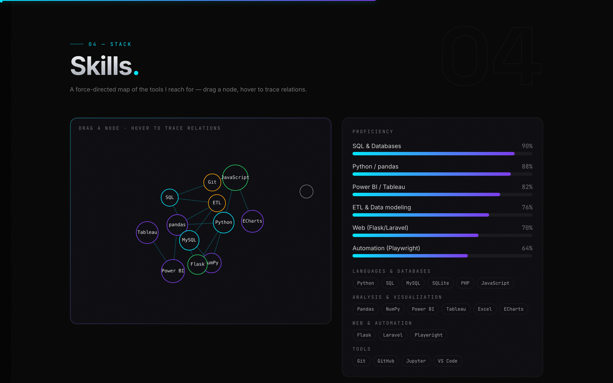
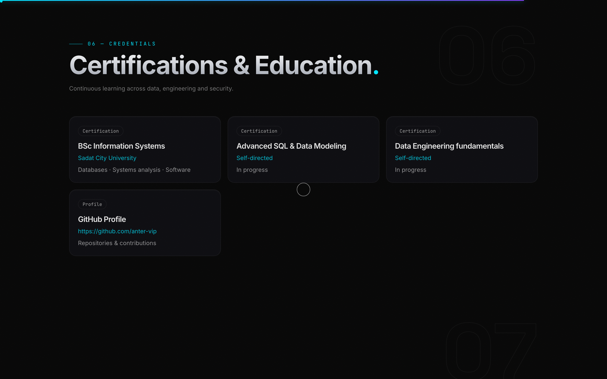
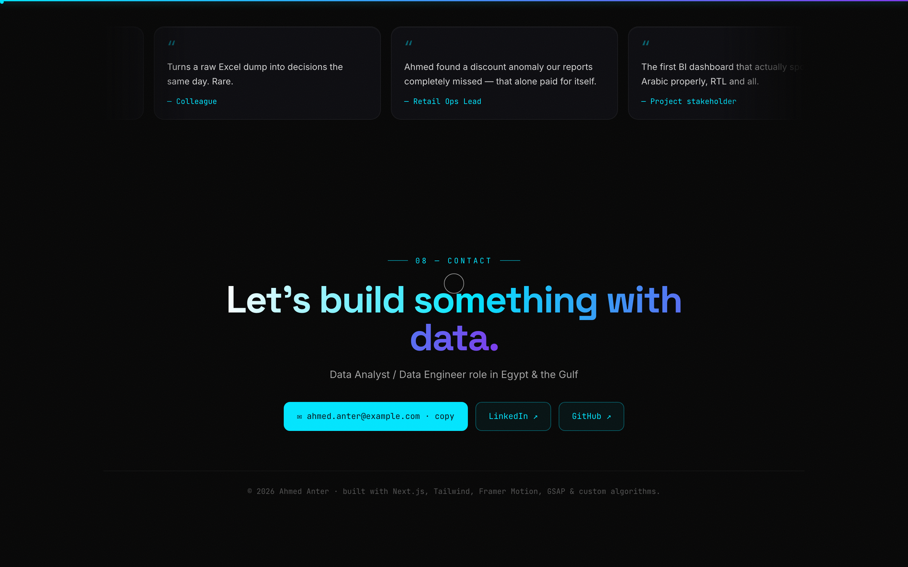

<div align="center">

# 🌙 Joot — Portfolio مش زي أي بورتفوليو

**«الغالبية بيحطوا سيرتهم الذاتية على صفحة… أنا حطيت *تجربة*.»**

موقع شخصي بصفحة واحدة، لكن كل بوصة فيه محسوبة: Smooth scroll فيزيائي،
Cursor مخصص، حروف بتكتب نفسها زي الـ Terminal، Sections بتظهر مع السكرول،
وزراير بتنجذب للمؤشر. **الرسالة: اللي يهتم بالتفاصيل دي، هيهتم بالتفاصيل في الداتا كمان.**



[](#)
[](#)
[](#)
[](#)
[](#)

</div>

---

## 📖 الفكرة

كل الـ portfolios بتقول "أنا عملت كذا وكذا". **Joot** بيخلّي الزائر *يحس*
بالمستوى قبل ما يقرا عنه — من أول الـ headline اللي بيتكتب حرف حرف كأنك
في Terminal، لحد الـ grain السينمائي فوق الصفحة.

### 🎯 فلسفة التصميم
- **صفحة واحدة، رحلة واحدة:** Hero → About → Experience → Projects → Skills → Contact.
- **الموشن مش زينة:** كل أنيميشن بيخدم معلومة — السكرول = الاكتشاف.
- **مصدر واحد للحقيقة:** كل النصوص والبيانات في ملف واحد — `src/data/profile.ts`.

---

## 📸 الجولة

| About — القصة بصوت أول | Experience — خط زمني واضح |
|---|---|
|  |  |

| Projects — الشغل بالكارتات | Skills — التصنيف بالوزن |
|---|---|
|  |  |

| Credentials — الشهادات | Contact — الخاتمة |
|---|---|
|  |  |

---

## ✨ المميزات التقنية

| الميزة | التنفيذ |
|---|---|
| 🖱️ **Custom Cursor** | مؤشر بيغلب على العناصر التفاعلية وبيكبر مع الـ hover |
| 🌊 **Physics Smooth Scroll** | Lenis — سكرول بتسارع ناعم مش قفزات |
| ⌨️ **Typed Headline** | عنوان الـ Hero بيتكتب حرف حرف ستايل تيرمينال |
| 🔡 **Scramble Text** | العناوين بتفك شفرة نفسها وهي بتظهر (تمهيد لـ CipherQuest 😉) |
| 🧲 **Magnetic Buttons** | الأزرار بتنجذب لشوية للمؤشر قبل الضغط |
| 🎬 **Reveal on Scroll** | كل Section بيظهر في وقته بالظبط (Framer Motion `whileInView`) |
| 📊 **Scroll Progress** | خيط نيون فوق الصفحة بيوريك إنت فين |
| 🎞️ **Film Grain** | طبقة حبيبات سينمائية خفيفة فوق الخلفية كلها |
| 📱 **Responsive** | التجربة نفسها على الموبايل بدون أنيميشن تقيل |

---

## 🏗️ الأركيتيشر

```
src/
├── data/
│   └── profile.ts        ← 🎯 SOURCE OF TRUTH — عدّل هنا وبس
├── components/
│   ├── sections/         ← Hero · About · Experience · Projects ·
│   │                        Skills · Certifications · Contact
│   ├── Cursor.tsx        ← مؤشر مخصص
│   ├── SmoothScroll.tsx  ← Lenis wrapper
│   ├── MagneticButton.tsx
│   ├── TypeLine.tsx      ← كتابة الـ headline
│   ├── ScrambleText.tsx  ← فك التشفير
│   ├── Reveal.tsx        ← ظهور بالسكرول
│   ├── Grain.tsx         ← الحبيبات السينمائية
│   └── ScrollProgress.tsx
└── app/
    ├── layout.tsx        ← الخطوط + الـ metadata
    └── page.tsx          ← ترتيب الرحلة
```

### 📝 تحديث الموقع = ملف واحد

عايز تغيّر أي نص، تضيف خبرة، تعدّل الإحصائيات؟
كله في [profile.ts](src/data/profile.ts) — بدون ما تلمس أي component:

```ts
export const profile = {
  name: "Ahmed Anter",
  typedHeadline: "> Data Analyst | Software Developer | ...",
  stats: [{ label: "Projects shipped", value: 12, suffix: "+" }, ...],
  experience: [ ... ],
}
```

---

## 🧰 Tech Stack

| الطبقة | الأداة | الدور |
|---|---|---|
| Framework | Next.js 14 | Static-friendly، سريع، SEO جاهز |
| Animation | Framer Motion 11 | Reveals + micro-interactions |
| Scroll | GSAP + Lenis | Timing + فيزياء السكرول |
| Styling | Tailwind CSS | ثيم داكن موّحد |
| Language | TypeScript | بيانات الـ profile كلها typed |

---

## 🚀 التشغيل

```bash
npm install
npm run dev      # → http://localhost:3001
npm run build    # إنتاج — ينشر على Vercel/Netlify بضغطة
```

---

<div align="center">

**Joot** — لأن الانطباع الأول بيتعمل مرة واحدة، فخليه يتعمل صح. 🌙

Built by **Ahmed Anter** · [anter-vip](https://github.com/anter-vip)

</div>
